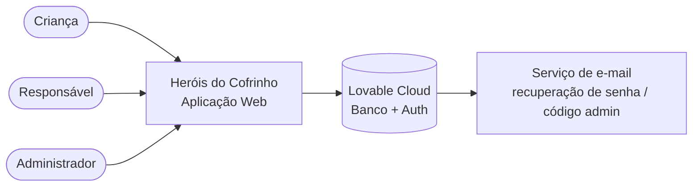
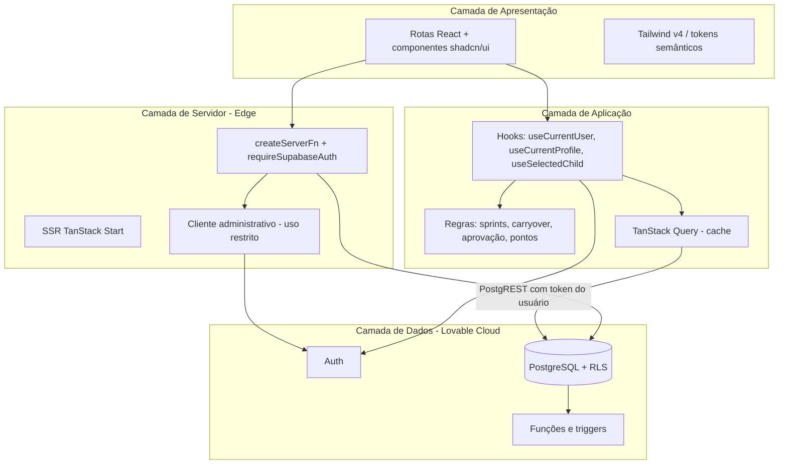
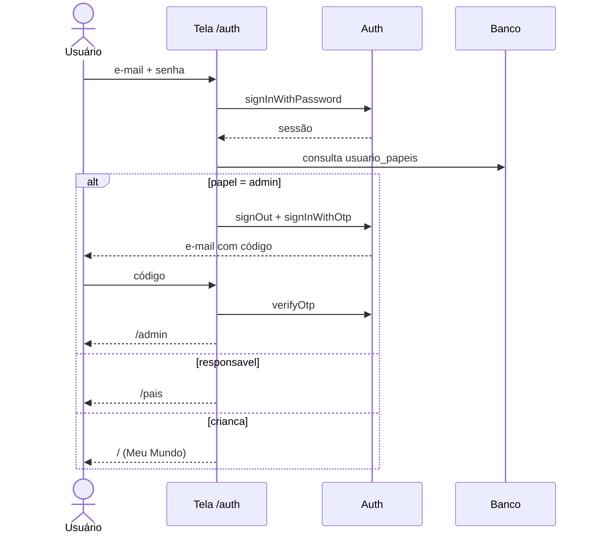
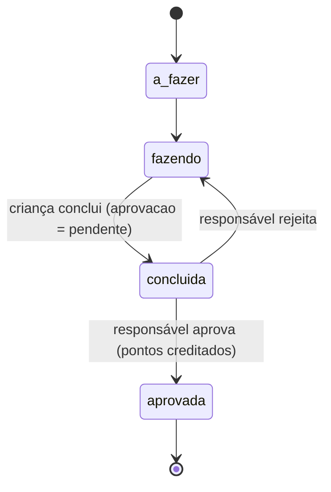
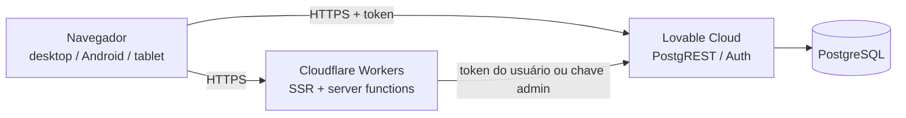

# Especificação da Arquitetura — Heróis do Cofrinho

| Item | Valor |
|---|---|
| Versão do documento | 1.0 |
| Data | Outubro/2026 |
| Escopo | Arquitetura lógica, física, de dados, de segurança e de implantação |
| Base | Implementação existente no repositório |

---

## 1. Introdução

### 1.1 Objetivo
Descrever a arquitetura da aplicação **Heróis do Cofrinho**, plataforma web gamificada de educação financeira infantil, servindo de referência para manutenção, evolução e auditoria.

### 1.2 Escopo do sistema
- Gestão de crianças vinculadas a responsáveis, com login próprio para cada criança.
- Tarefas em quadro Kanban organizadas em sprints semanais, com aprovação parental.
- Economia de pontos (1 ponto = R$ 0,50) trocáveis apenas por recompensas cadastradas pelos responsáveis.
- Metas, conquistas, avatar, mascote guia e jornada educativa (história + quiz).

### 1.3 Partes interessadas
| Ator | Interesse |
|---|---|
| Criança | Executar tarefas, acompanhar o cofrinho, aprender e resgatar recompensas |
| Responsável | Cadastrar crianças, tarefas, metas e recompensas; aprovar conclusões |
| Administrador | Visão geral da plataforma e acesso total aos dados |
| Equipe técnica | Manter e evoluir a solução |

---

## 2. Requisitos Arquiteturais

### 2.1 Direcionadores
| Requisito | Decisão arquitetural |
|---|---|
| Segurança dos dados das crianças | Row Level Security em todas as tabelas; papéis em tabela separada |
| Acesso por celular/tablet | Interface responsiva; Kanban com botões de seta para touch |
| Baixa latência | SSR e funções de servidor executadas no edge (Cloudflare Workers) |
| Manutenibilidade | TypeScript estrito, tipos do banco gerados, roteamento por arquivos |
| Simplicidade operacional | Backend gerenciado (Lovable Cloud) sem servidores próprios |
| Autenticação forte do admin | Segunda etapa por código enviado ao e-mail |

### 2.2 Restrições
- Framework fixo: TanStack Start v1 (React 19, Vite 7).
- Runtime de servidor: workerd (Cloudflare Workers) — sem APIs exclusivas de Node.js.
- Backend: Lovable Cloud (PostgreSQL, Auth, PostgREST).
- Nomenclatura do banco em português.

---

## 3. Visão Lógica

### 3.1 Diagrama de contexto

### 3.2 Camadas

### 3.3 Módulos funcionais
| Módulo | Rotas | Responsabilidade |
|---|---|---|
| Autenticação | `/auth`, `/forgot-password`, `/reset-password` | Login, cadastro, código admin, recuperação de senha |
| Painel da criança | `/` (Meu Mundo) | Saudação, cofrinho, nível, progresso |
| Tarefas | `/tarefas`, `/sprints` | Kanban, sprint semanal, histórico |
| Economia | `/recompensas`, `/metas` | Loja de recompensas e metas de economia |
| Gamificação | `/conquistas`, `/avatar` | Medalhas e personalização |
| Educação | `/historia`, `/quiz` | Capítulos e quizzes por criança |
| Gestão | `/criancas`, `/pais`, `/admin` | Cadastro de crianças, aprovações, KPIs |

---

## 4. Visão de Componentes

| Componente | Local | Função |
|---|---|---|
| Layout raiz | `src/routes/__root.tsx` | HTML, fontes, metadados, Toaster |
| Guarda de sessão | `src/routes/_authenticated/route.tsx` | Redireciona para `/auth` sem sessão (SSR desativado) |
| Layout do app | `src/routes/_authenticated/_app.tsx` | Sidebar, header, seletor de criança, `ensureSprintForChild` |
| AppSidebar | `src/components/AppSidebar.tsx` | Menu conforme papel |
| ChildSelector | `src/components/ChildSelector.tsx` | Troca da criança ativa |
| PiggyBank | `src/components/PiggyBank.tsx` | Cofrinho visual |
| auth.ts | `src/lib/auth.ts` | Papel principal, rota inicial por papel, erros amigáveis |
| sprints.ts | `src/lib/sprints.ts` | Criação de sprint, carryover, tarefas recorrentes |
| child-login.functions.ts | `src/lib/child-login.functions.ts` | Criar/remover login de criança (servidor) |
| start.ts | `src/start.ts` | Middlewares: erro global e envio do token às funções |

---

## 5. Visão de Processos (fluxos principais)

### 5.1 Login com roteamento por papel e código do administrador

### 5.2 Ciclo de tarefa com aprovação parental

### 5.3 Abertura de sprint semanal
1. A cada acesso ao layout `_app`, `ensureSprintForChild` verifica o sprint da semana (segunda a domingo).
2. Se não existir, cria o sprint e transfere tarefas únicas não concluídas.
3. Recria tarefas recorrentes: diárias com a data do dia; semanais com a data da segunda-feira.
4. Se a diária do dia não estiver concluída/existente, cria nova em "A fazer".

### 5.4 Criação de login infantil
Responsável/Admin chama `createChildLogin` → middleware valida o token → verifica vínculo com a criança → cliente administrativo cria o usuário → grava `criancas.usuario_id` e papel `crianca`.

---

## 6. Visão de Dados

- 10 tabelas: `perfis`, `usuario_papeis`, `criancas`, `sprints`, `tarefas`, `recompensas`, `metas`, `conquistas`, `progresso_capitulos`, `tentativas_quiz`.
- Enums: `papel_app`, `status_tarefa`, `frequencia_tarefa`, `status_recompensa`.
- Funções: `tem_papel`, `obter_papel_usuario`, `pode_acessar_crianca`, `tratar_novo_usuario`, `atualizar_atualizado_em`.
- Todos os dados de uso são escopados por `crianca_id`.

O diagrama ER completo está em [modelo-de-dados.md](modelo-de-dados.md).

---

## 7. Visão de Segurança

| Controle | Implementação |
|---|---|
| Autenticação | E-mail/senha; código por e-mail para administrador; recuperação de senha |
| Autorização | Papéis em `usuario_papeis`, verificados por funções `security definer` |
| Isolamento de dados | RLS em todas as tabelas via `tem_papel()` e `pode_acessar_crianca()` |
| Operações privilegiadas | Apenas no servidor, após validar o token e o vínculo do chamador |
| Cadastro público | Somente Responsável (Admin exige código de convite) |
| Validação | Zod no cliente e nas funções de servidor |
| Antifraude de pontos | Pontos só creditados após aprovação; estorno se a tarefa voltar |

---

## 8. Visão Física / Implantação

| Ambiente | Endereço |
|---|---|
| Publicado | https://heroisdocofrinho.lovable.app |
| Código-fonte | GitHub (sincronização com o Lovable) |

Uma única instância do backend atende preview e versão publicada.

---

## 9. Tecnologias

| Camada | Tecnologia |
|---|---|
| Linguagem | TypeScript 5.8 |
| UI | React 19, Tailwind CSS v4, shadcn/ui, Radix, Lucide |
| Framework | TanStack Start v1, Router v1, Query v5 |
| Formulários | React Hook Form + Zod |
| Build | Vite 7 |
| Backend | Lovable Cloud (PostgreSQL, Auth, PostgREST) |
| Runtime | Cloudflare Workers |

---

## 10. Qualidade, Riscos e Evolução

| Tema | Situação / recomendação |
|---|---|
| Testes | Recomendado: Vitest (regras de pontos/sprints), testes de RLS, Playwright E2E e mobile |
| Código admin por e-mail | Modelo padrão envia link; código numérico exige domínio de e-mail próprio |
| Login social | Pula a segunda etapa do administrador |
| Painel admin | Apenas KPIs; gestão de papéis ainda não existe |
| Convite admin | Código validado no cliente; recomendável validar no servidor |
